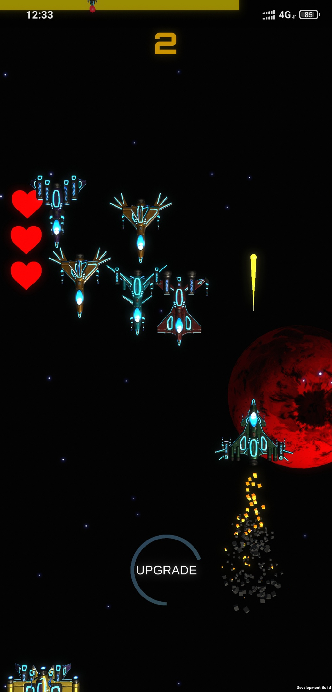

# SpaceShips

**Dodge, upgrade and survive together.** A mobile sci-fi arcade shooter built in 24 hours for the Vezdekod hackathon, combining automatic fire, touch-driven flight and a two-player cooperative mode.

**Stack:** Unity 2019.4.12f1 · C# · Android · Photon PUN

**My role:** Danil Volodin — shooting and movement mechanics, UI, emissive texture adjustments, particle effects, ship upgrades and game balance.

## Open the project

The original playable source is on the **`Final` branch**, which is the repository's default branch.

1. Clone or download the `Final` branch.
2. In Unity Hub, open the `SpaceShips-Unity` folder (it contains `Assets`, `Packages` and `ProjectSettings`).
3. Use **Unity 2019.4.12f1**, the version recorded in `ProjectSettings/ProjectVersion.txt`, to minimize migration changes.
4. Open `Assets/Scenes/Menu.unity` and enter Play mode.
5. Choose the local mode first. For Android builds, install the matching Unity Android Build Support modules and review the build settings.

The configured build scenes are `Menu`, `LocalGame` and `CooperativeGame`.

### Cooperative play

Co-op uses **Photon PUN** with two-player rooms. Configure your own Photon application in `PhotonServerSettings` before relying on online play; do not assume the historical project configuration is still active. Both clients need compatible game settings. Current online service availability has not been tested in this documentation update.

### Historical Android build

The original README linked an [Android APK on Google Drive](https://drive.google.com/file/d/1O5Q2r9BL2rVopBQPxmpNZnf8kYWpsdOY/view?usp=sharing). This legacy download is retained for reference; availability and compatibility have not been revalidated.

## Gameplay

- **Immediate action:** the ship fires automatically while you focus on movement.
- **Touch controls:** hold and move a finger on screen to steer; the code also uses mouse input in the Editor.
- **Ship progression:** earn points and upgrade the ship in the local mode.
- **Rising pressure:** enemy spawning and level progression keep the action moving.
- **Solo or co-op:** play locally or join another pilot through Photon networking.
- **Arcade presentation:** emissive ship materials, particle effects, sound and a scrolling space backdrop.

## Code map

| Script | Responsibility |
| --- | --- |
| `Player.cs` | Movement, automatic fire, damage and ship upgrades |
| `Bullet.cs` / `Enemy.cs` | Projectile and enemy behavior |
| `GameController.cs` | Score, upgrade availability and level progression |
| `Spawner.cs` / `ManagerSpawner.cs` | Enemy spawning |
| `LobbyManager.cs` | Photon connection and two-player lobby flow |
| `GameManagerPhoton.cs` | Networked player spawning |
| `Menu.cs` | Entry into local gameplay |

Game scripts are in the Unity project's `Assets/Scripts/` directory.

## Team and contributions

**Danil Volodin** — shooting and movement mechanics, UI, emissive texture adjustments, particle effects, ship upgrades and game balance.

**Artem Spitsin** — Photon networking, enemy spawning, difficulty progression, the background and game balance.

The original project notes report a maximum score in the hackathon's GameDev category.

## Project status

Preserved as a time-boxed hackathon project and portfolio piece. This README describes the checked-in implementation; it does not imply that the game has been ported to current Unity versions or freshly tested on modern Android devices.

The surviving original screenshot is stored in `docs/screenshots/gameplay-2.jpg`.

## License

Original project code is available under the [MIT License](LICENSE). Third-party assets and Photon components retain their respective licenses.
